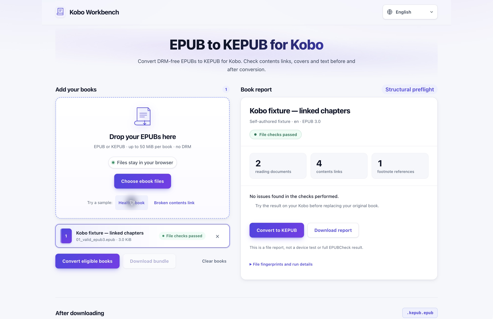

# Kobo Workbench

Convert DRM-free EPUB books to KEPUB and inspect the result before copying it to a Kobo.

[Convert EPUB to KEPUB and check book structure](https://kobo-workbench.pages.dev/)

## Conversion needs a check

A downloaded file can still contain a broken contents link or a missing resource. Kobo Workbench checks the input structure and compares text, cover bytes, and link targets across conversion.

- Process files in the browser.
- Inspect reading documents, contents links, and footnote references.
- Try healthy-book and broken-contents-link samples.
- Download conversion results and reports.

## Use the result on a Kobo

1. Load a DRM-free EPUB or try a sample.
2. Read the preflight report and resolve issues it identifies.
3. Convert an eligible book and review the comparison.
4. Keep the complete `.kepub.epub` filename, copy the file over USB, and safely eject the device.
5. Open the cover, contents menu, footnotes, and several pages on the Kobo.

The screenshot shows a bundled test fixture, not a physical-device test. These checks are structural preflight, not full EPUBCheck validation. The tool does not remove DRM.

[Open the EPUB-to-KEPUB converter](https://kobo-workbench.pages.dev/)
